# Milestone v1.2 Audit Report: 3D Planetary Hub, Subject Cartography & Rocket Return

**Audit Date:** 2026-11-09  
**Status:** **PASSED / FULLY CERTIFIED**  
**Auditor:** `gsd-audit-milestone` with `gsd-integration-checker`

---

## 1. Executive Summary

Milestone **v1.2** ("3D Planetary Hub, Subject Cartography & Rocket Return") has successfully delivered all planned features, technical requirements, and quality standards. 

Across 5 execution phases (Phases 09 to 13), the project transformed from a 2D prompt adventure on Earth into an immersive, bilingual 3D solar system educational experience aligned with Malaysian KSSR Semakan & KBAT pedagogy.

---

## 2. Requirements Traceability & Verdict

All 14 active requirements across the 5 domains are **100% satisfied**:

| Domain | Requirement | Description | Status | Evidence |
|---|---|---|---|---|
| **Planetary Schema** | `SCHEMA-01` | Update planetary schema to reflect user-defined subject mapping (Earth=Prompting, Moon=BM, Mars=English, Venus=Matematik, Mercury=Moral) | ✓ SATISFIED | `src/lib/kids/planets.ts` (`PLANET_WORLDS`) |
| | `SCHEMA-02` | 7 distinct geological features per planet corresponding to Tahun 1-6 + Capstone Boss | ✓ SATISFIED | 35 authentic features defined in `planets.ts` |
| | `SCHEMA-03` | Symmetrical bilingual metadata across all planets & features (`en` and `ms`) | ✓ SATISFIED | `messages/{en,ms}.json` (`kids.planets.*`) |
| **3D Three.js Explorer** | `THREE-01` | SSR-Safe Three.js integration with unmount GPU buffer disposal | ✓ SATISFIED | `src/components/kids/planets/planetary-canvas.tsx` |
| | `THREE-02` | Interactive 3D Solar System View with Sun, orbits, and pointer drag filter raycasting | ✓ SATISFIED | `solar-system-scene.ts` & `planetary-interaction.ts` |
| | `THREE-03` | Deep Planet Cartography with elevated boundary rings, beacon pins, and camera glide | ✓ SATISFIED | `planet-cartography-scene.ts` |
| | `THREE-04` | Glassmorphic Telemetry HUD overlay with province list & 2x2 telemetry cards | ✓ SATISFIED | `planetary-hud.tsx` & `/planets` route |
| **Game Flow & Rocket** | `FLOW-01` | Title Screen dual entry paths (Start on Earth vs Explore Solar System) | ✓ SATISFIED | `src/components/kids/layout/kids-home-content.tsx` |
| | `FLOW-02` | Earth as foundational starting world with bi-directional space navigation | ✓ SATISFIED | Header rocket button & Map space portal banner |
| | `FLOW-03` | Grand Rocket Launch sequence on Earth graduation (`5-4-graduation-day`) | ✓ SATISFIED | `RocketLaunchOverlay` & `LevelComplete` |
| **Theming & Pedagogy** | `THEME-01` | Dynamic celestial lesson background (clouds, lunar slate, Martian dust, Venusian glow) | ✓ SATISFIED | `src/components/kids/layout/planet-background.tsx` |
| | `PEDAG-01` | Curriculum alignment for BM, English, Math, and Moral prompt tasks | ✓ SATISFIED | `src/lib/kids/levels.ts` realigned to Worlds 1-9 |
| | `PEDAG-02` | Minimum 7 interactive `<Section>` stages per subject lesson | ✓ SATISFIED | All 4 subject lessons in `en` and `ms` have $\ge 7$ stages |
| **Quality & Certification** | `GATE-01` | Clean typecheck, 0 ESLint errors, clean import closure, and Malay vocabulary guard | ✓ SATISFIED | 245/245 tests green, 0 ESLint errors, 0 vocab violations |
| | `GATE-02` | 100% Static export certification (`output: 'export'`) with `/planets` verification | ✓ SATISFIED | `scripts/verify-project.js` passes exit 0 |

---

## 3. End-to-End User Flows

```mermaid
flowchart LR
    classDef startNode fill:#3b82f6,stroke:#1d4ed8,stroke-width:2px,color:#ffffff;
    classDef hubNode fill:#8b5cf6,stroke:#6d28d9,stroke-width:2px,color:#ffffff;
    classDef earthNode fill:#10b981,stroke:#047857,stroke-width:2px,color:#ffffff;
    classDef lessonNode fill:#f59e0b,stroke:#b45309,stroke-width:2px,color:#ffffff;
    classDef rocketNode fill:#ec4899,stroke:#be185d,stroke-width:2px,color:#ffffff;

    A["Title Screen"]:::startNode --> B["Start on Earth"]:::earthNode
    A --> C["Explore Solar System"]:::hubNode
    
    B --> D["Earth Map & 19 Levels"]:::earthNode
    D --> E["Graduation Day"]:::lessonNode
    E --> F["Rocket Launch Overlay"]:::rocketNode
    F --> C
    
    C --> G["Planet Cartography"]:::hubNode
    G --> H["Subject Lessons (7 Stages)"]:::lessonNode
```

- **Flow 1 (Title to Space)**: Cadets can jump directly from the title screen into the 3D Solar System View, inspect orbits, and transition into planet cartography.
- **Flow 2 (Foundational Earth Journey)**: Cadets beginning on Earth complete the 19 core levels, graduating at `5-4-graduation-day` where a retro 3.. 2.. 1.. BLAST OFF! rocket sequence launches Peromfu to `/planets`.
- **Flow 3 (Global Return Navigation)**: The top navigation header and Earth's 2D world map provide persistent rocket links to the 3D space hub at any time.
- **Flow 4 (Rich Subject Pedagogy)**: Launching missions from the Moon, Mars, Venus, or Mercury takes cadets to 7-stage interactive lessons with matching celestial atmosphere and accent colors.

---

## 4. Quality & Gate Status

- **Typecheck (`tsc --noEmit`):** PASSED (0 errors).
- **Unit & Component Tests (`npm test`):** PASSED (245/245 tests green across 21 test files).
- **Linter (`npm run lint`):** PASSED (0 errors).
- **Kids Import Closure (`check:closure`):** PASSED (406 modules, 0 unresolved imports).
- **Malay Vocabulary Guard (`check:vocab`):** PASSED (23 MDX files, 0 forbidden loanwords).
- **Static Export Certification (`npm run verify`):** PASSED (certifies `/`, `/map`, `/planets`, all 23 level routes, and bundled media).

---

## 5. Milestone Completion Recommendation

Milestone **v1.2** is verified complete and ready to be archived via `/gsd-complete-milestone`.
