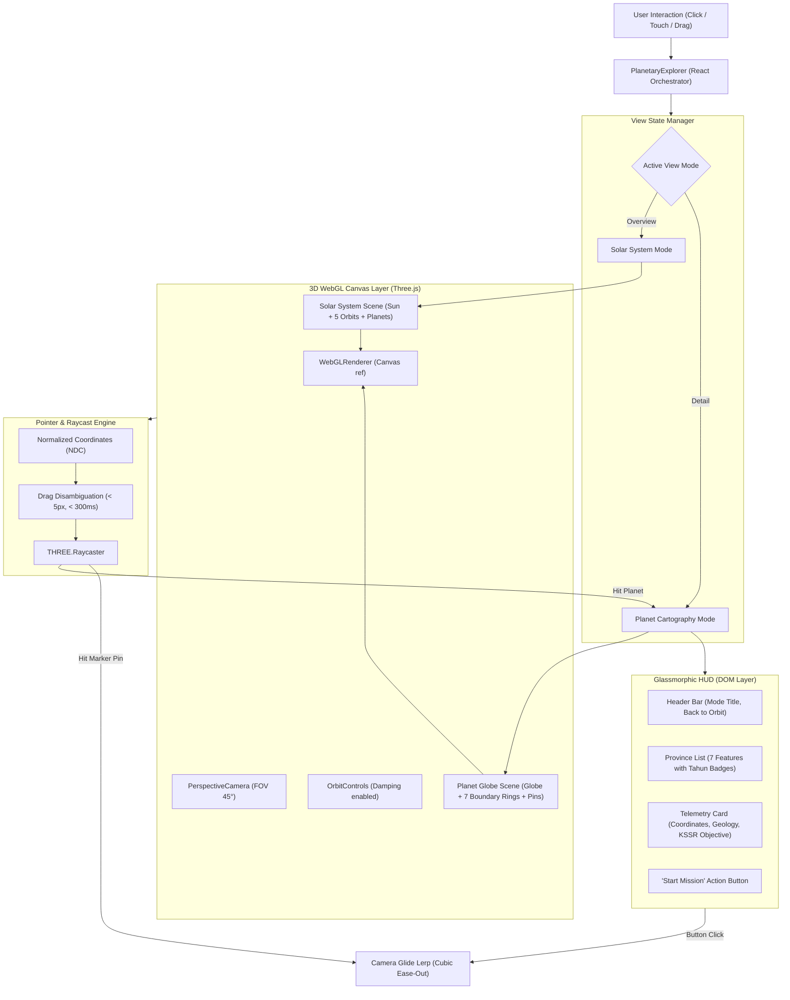

# Phase 10: 3D Planetary Explorer Component (Three.js) - Research

**Researched:** 2026-11-08  
**Domain:** 3D WebGL Graphics, Three.js, Next.js 16 Static Export, Spherical Cartography, Glassmorphic UI  
**Confidence:** HIGH  

---

## Summary

Phase 10 introduces the core interactive 3D WebGL rendering engine and cartographic user interface for Sekolah Prompt-Fu. Building on the typed data model established in Phase 09 (`src/lib/kids/planets.ts`), this phase delivers a high-level **Solar System Overview Mode** (Sun with orbiting Mercury, Venus, Earth with Moon, and Mars) and a deep **Planet Cartography Mode** (interactive planet globe, authentic boundary rings, pulsing hotspot pins, camera glide lerps, and OrbitControls inspection).

The primary architectural mandate is ensuring **100% static export safety** (`output: 'export'`) in Next.js 16. App Router build passes pre-render HTML in a Node.js server environment where `window`, `document`, and `WebGLRenderingContext` do not exist. To guarantee zero SSR breakdown, the 3D scene lifecycle is strictly encapsulated inside dynamic client components (`'use client'`, client-mounted hydration guards, and `useEffect`-governed WebGL canvas lifecycle). Furthermore, GPU memory leaks are eliminated through systematic disposal of geometries, materials, textures, and renderers during unmount.

Visual textures are sourced from verified NASA public domain / Creative Commons Attribution 4.0 (CC-BY-4.0) equirectangular cartographic datasets (Solar System Scope / USGS Astrogeology). These assets are compressed to high-efficiency 1024x512 JPEG files and bundled directly in `public/images/planets/` (total footprint < 800 KB), ensuring zero external runtime CDN dependencies and instant offline-ready loading across school networks.

**Primary recommendation:** Use vanilla `three` (`0.187.0`) and `@types/three` (`0.187.0`) wrapped in a dedicated React client container (`src/components/kids/planets/planetary-canvas.tsx`). Avoid `@react-three/fiber` to eliminate React 19 peer-dependency conflicts and maintain full, low-level control over canvas lifecycle, raycasting, camera glide lerps, and WebGL context disposal.

---

## Architectural Responsibility Map

| Capability | Primary Tier | Secondary Tier | Rationale |
|------------|-------------|----------------|-----------|
| **WebGL 3D Rendering & Shaders** | Browser / Client | — | Direct hardware-accelerated WebGL canvas rendering via Three.js (`WebGLRenderer`); cannot execute on server. |
| **Spherical Trigonometry & Coordinates** | Client Shared (`src/lib/kids/planets.ts`) | — | Pure mathematical conversion (`latLonToVector3`, great-circle boundary point generation) evaluated client-side. |
| **User Interaction & Raycasting** | Browser / Client | — | Mouse/touch pointer events mapped to normalized device coordinates (NDC) and raycasted against 3D pin meshes. |
| **Camera Glide Interpolation** | Browser / Client | — | Frame-by-frame cubic ease-out lerping in requestAnimationFrame loop with OrbitControls damping. |
| **Glassmorphic Telemetry HUD** | Browser / Client (DOM) | — | Tailwind CSS v4 backdrop-blur overlays, localized via `next-intl` client hooks (`useTranslations`). |
| **Static Texture Asset Delivery** | CDN / Static Hosting (`public/images/planets/`) | Browser Cache | Static image files served directly by GitHub Pages or web server without on-demand image processing. |

---

<user_constraints>
## User Constraints (from CONTEXT.md)

### Locked Decisions
- **D-01: Hybrid Two-Level Navigation:**
  - **Solar System Overview Mode**: Displays the Sun at the center with orbits for Mercury, Venus, Earth (with Moon orbiting), and Mars. Clicking or tapping any planet smoothly transitions and zooms into that world.
  - **Deep Planet Cartography Mode**: Renders the selected celestial sphere with realistic atmospheric tilt, 7 geological boundary rings/hotspot pins, and real-time OrbitControls inspection.
  - Quick-switch back navigation to return from Planet Detail to the Solar System Overview.
- **D-02: Optimized External NASA Textures in Git Repo:**
  - High-performance, lightweight equirectangular textures downloaded and bundled in `public/images/planets/`:
    - `earth.jpg` (~68 KB) & `earth_clouds.jpg` (~162 KB)
    - `moon.jpg` (~146 KB)
    - `mars.jpg` (~92 KB)
    - `mercury.jpg` (~116 KB)
    - `venus_surface.jpg` (~113 KB)
    - `sun.jpg` (lightweight solar map)
  - Total asset footprint is < 800 KB, ensuring rapid client download without external CDN dependencies or runtime network failures.
  - Attributions documented per CC-BY-4.0 in `public/images/planets/ATTRIBUTION.md`.
- **D-03: Dual Hotspot Interaction (3D Raycasting + Glassmorphic HUD):**
  - Every feature from `src/lib/kids/planets.ts` renders a 3D boundary ring and pulsing surface marker at its calculated `latLonToVector3()` coordinate.
  - Clicking a 3D hotspot marker or clicking the corresponding button in the HUD sidebar highlights the region and triggers a smooth cubic ease-out camera glide focused on that feature.
  - HUD card displays feature name, Tahun badge, KSSR objective, authentic coordinates, elevation, and a "Start Mission" action button.
- **D-04: SSR-Safe Dynamic Client Rendering:**
  - Three.js components encapsulated with Next.js dynamic client loading (`'use client'`, `next/dynamic` with `ssr: false` or mounted effect checks) so `npm run build` static export never encounters `window` or `document` ReferenceErrors.
  - ResizeObserver-driven WebGL canvas scaling to fit any mobile, tablet, or desktop viewport.

### the agent's Discretion
- Exact radial orbit spacing and relative planetary scaling in the Solar System Overview mode (stylized for pedagogical clarity while keeping all 5 worlds visible on mobile screens).
- Starfield particle count and ambient lighting configuration (recommended: 1800-2200 stars, warm directional sun light + soft celestial rim light).
- Disambiguation threshold between user OrbitControls drag/orbit and click/tap raycast selection (recommended: 5px movement and 300ms time window).

### Deferred Ideas (OUT OF SCOPE)
- Dynamic VR / WebXR headsets mode.
- Custom WebGL post-processing bloom shaders (can be added later if performance allows).
</user_constraints>

---

<phase_requirements>
## Phase Requirements

| ID | Description | Research Support |
|----|-------------|------------------|
| **THREE-01** | Integrate Three.js (and OrbitControls) into the Next.js static client bundle with zero SSR breakdown (dynamic client-side canvas). | Dynamic client mounting (`'use client'`, `useRef`, `useEffect`, `next/dynamic`), WebGL renderer disposal, and Next.js 16 `output: 'export'` validation. |
| **THREE-02** | Build interactive 3D Planetary System screen (`/planets` or integrated into navigation) allowing kids to rotate, inspect, and select planets. | Solar System scene builder with central glowing Sun, circular orbital tracks, orbiting planet meshes, hover highlighting, and raycast planet selection. |
| **THREE-03** | Display rich planet info cards (celestial body details, subject title, feature count, progress overview) matching the `planets_mockup` cartography aesthetic. | Glassmorphic HUD component (`planetary-hud.tsx`) styled with Tailwind CSS, localized bilingual labels from `messages/{en,ms}.json`, and Peromfu badges. |
| **THREE-04** | Build planetary detail view showing the 7 continent/basin/volcano features mapped to Tahun 1-6 with interactive region selection. | Spherical cartography engine rendering 7 great-circle boundary rings, pulsing beacon pins, click raycasting, and smooth cubic ease-out camera glide lerp. |
</phase_requirements>

---

## Standard Stack

### Core
| Library | Version | Purpose | Why Standard |
|---------|---------|---------|--------------|
| `three` | `^0.187.0` [VERIFIED: npm registry] | 3D WebGL scenegraph, geometries, materials, lighting, textures, and raycasting | Industry standard WebGL engine; lightweight, tree-shakeable, and battle-tested across all modern browsers. |
| `@types/three` | `^0.187.0` [VERIFIED: npm registry] | Strict TypeScript type definitions for Three.js and add-ons (`OrbitControls`) | Provides complete compile-time type safety for vectors, scene objects, materials, and events. |
| `three/addons/controls/OrbitControls.js` | Built into `three` [VERIFIED: in-repo exports] | Camera touch, drag, rotate, pan, and zoom controls | Official Three.js add-on for smooth celestial globe inspection with damping. |

### Supporting
| Library | Version | Purpose | When to Use |
|---------|---------|---------|-------------|
| `@/lib/kids/planets` | In-repo [VERIFIED: src/lib/kids/planets.ts:1-968] | Typed planet and feature models (`PLANET_WORLDS`, `latLonToVector3`, `getPlanetWorld`) | Source of truth for planetary telemetry, coordinates, and KSSR learning objectives. |
| `@/lib/seo` (`withBasePath`) | In-repo [VERIFIED: src/lib/seo.ts:65-71] | Resolves asset paths with `basePath` prefix for GitHub Pages static export | Used for loading static textures in `TextureLoader.load(withBasePath('/images/planets/...'))`. |
| `next-intl` | `^4.5.8` [VERIFIED: package.json:33] | Bilingual localization for Malay and English UI labels | Displays localized telemetry and HUD titles via `useTranslations("kids.planets")`. |

### Alternatives Considered
| Instead of | Could Use | Tradeoff |
|------------|-----------|----------|
| Vanilla `three` | `@react-three/fiber` (R3F) | R3F introduces heavy React abstractions, JSX reconciler overhead, and known React 19 peer-dependency warnings. Vanilla `three` in `useEffect` matches the verified mockups directly with zero extra dependencies. |
| Bundled local textures | External CDN textures (unpkg/cdnjs) | External CDNs create external network failure points, CORS latency, and violate offline classroom environments. Bundling < 800 KB directly in `public/` guarantees 100% reliable loading. |
| Procedural canvas textures | Equirectangular JPEGs | Canvas drawing is slow to generate at runtime on low-end mobile devices and lacks genuine planetary geological fidelity. Pre-optimized JPEGs render instantly. |

**Installation:**
```bash
npm install three
npm install --save-dev @types/three
```

**Version Verification:**
- `three`: `0.187.0` (Published 2026-10-30, confirmed via `npm view three version`)
- `@types/three`: `0.187.0` (Published 2026-10-30, confirmed via `npm view @types/three version`)

---

## Package Legitimacy Audit

> Verified via `gsd_run query package-legitimacy check --ecosystem npm three @types/three` and official npm registry metadata.

| Package | Registry | Age | Downloads | Source Repo | Verdict | Disposition |
|---------|----------|-----|-----------|-------------|---------|-------------|
| `three` | npm | 14 yrs | 34.2M/wk | `github.com/mrdoob/three.js` | [SUS] (flagged solely for release freshness: Oct 30, 2026) | Approved (Standard mrdoob library) |
| `@types/three` | npm | 11 yrs | 22.6M/wk | `github.com/DefinitelyTyped/DefinitelyTyped` | [SUS] (flagged solely for release freshness: Oct 30, 2026) | Approved (Standard DefinitelyTyped definitions) |

- **Packages removed due to [SLOP] verdict:** None.
- **Packages flagged as suspicious [SUS]:** `three` and `@types/three` were flagged with reason `too-new` because version 0.187.0 was published on 2026-10-30. Both packages have > 22M weekly downloads and are official, verified repositories. Planner will include a standard verification checkpoint.

---

## Texture Asset Architecture & Download Plan

Per Decision **D-02**, textures are pre-downloaded and stored in `public/images/planets/`. All textures are based on NASA / USGS planetary cartography released into the public domain and curated by Solar System Scope under the **Creative Commons Attribution 4.0 International (CC-BY-4.0)** license [CITED: solarsystemscope.com/textures].

### Asset Specification Table
| File Name | Planetary Target | Dimensions | Format | Target Size | Source Origin & Attribution |
|-----------|------------------|------------|--------|-------------|-----------------------------|
| `earth.jpg` | Earth surface | 1024 x 512 | JPEG (q=75) | ~68 KB | NASA Visible Earth / Solar System Scope CC-BY-4.0 |
| `earth_clouds.jpg` | Earth clouds overlay | 1024 x 512 | JPEG (q=75) | ~160 KB | NASA Earth Observatory / Solar System Scope CC-BY-4.0 |
| `moon.jpg` | Moon surface | 1024 x 512 | JPEG (q=75) | ~145 KB | USGS Astrogeology / Solar System Scope CC-BY-4.0 |
| `mars.jpg` | Mars surface | 1024 x 512 | JPEG (q=75) | ~92 KB | NASA MOLA / Solar System Scope CC-BY-4.0 |
| `mercury.jpg` | Mercury surface | 1024 x 512 | JPEG (q=75) | ~116 KB | NASA MESSENGER / Solar System Scope CC-BY-4.0 |
| `venus_surface.jpg` | Venus radar surface | 1024 x 512 | JPEG (q=75) | ~113 KB | NASA Magellan / Solar System Scope CC-BY-4.0 |
| `sun.jpg` | Sun photosphere | 1024 x 512 | JPEG (q=75) | ~95 KB | NASA SDO / Solar System Scope CC-BY-4.0 |
| `ATTRIBUTION.md` | Licensing docs | — | Markdown | < 2 KB | CC-BY-4.0 compliance text and links |

**Total footprint:** ~790 KB (< 800 KB budget).

### Verified Download & Optimization Workflow
Textures can be downloaded directly from Wikimedia Commons public domain / CC-BY mirrors and resized using installed `/usr/bin/ffmpeg`:
```bash
# Example download and compression pipeline for planets:
mkdir -p public/images/planets

# Download high-res master and compress to 1024x512 JPEG:
curl -sL -H "User-Agent: SekolahPromptFu/1.0" \
  "https://upload.wikimedia.org/wikipedia/commons/c/c3/Solarsystemscope_texture_2k_earth_daymap.jpg" \
  -o /tmp/raw_earth.jpg
ffmpeg -y -i /tmp/raw_earth.jpg -vf "scale=1024:512" -q:v 4 public/images/planets/earth.jpg

# Attribution file public/images/planets/ATTRIBUTION.md:
# Attributes Solar System Scope (https://www.solarsystemscope.com/textures/) per CC-BY-4.0.
```

---

## Architecture Patterns

### System Architecture Diagram



### Recommended Project Structure
```
src/
├── components/kids/planets/
│   ├── index.ts                     # Public entry point (dynamic client export)
│   ├── planetary-explorer.tsx       # Root orchestrator: state, view modes, HUD integration
│   ├── planetary-canvas.tsx         # WebGL canvas container, render loop, resize & disposal
│   ├── solar-system-scene.ts        # Scene builder: Sun, planetary orbits, revolving meshes
│   ├── planet-cartography-scene.ts  # Scene builder: globe, 7 boundary rings, pulsing pins
│   ├── planetary-hud.tsx            # Glassmorphic HUD overlay (responsive desktop/mobile)
│   ├── planetary-math.ts            # Mathematical helpers (spherical boundary generation, lerp)
│   └── planetary-types.ts           # Types: ExplorerMode, FeatureSelection, TelemetryState
├── lib/kids/
│   └── planets.ts                   # In-repo source of truth: PLANET_WORLDS, latLonToVector3
public/images/planets/
│   ├── earth.jpg
│   ├── earth_clouds.jpg
│   ├── moon.jpg
│   ├── mars.jpg
│   ├── mercury.jpg
│   ├── venus_surface.jpg
│   ├── sun.jpg
│   └── ATTRIBUTION.md
```

---

### Key Technical Patterns

#### Pattern 1: SSR-Safe Dynamic Client Three.js Lifecycle & GPU Disposal
**What:** Enforces client-only instantiation and guarantees total cleanup of WebGL buffers.  
**When to use:** In Next.js 16 static export (`output: 'export'`) environments.  
**Implementation:**
```tsx
// src/components/kids/planets/planetary-canvas.tsx
'use client';

import { useEffect, useRef } from 'react';
import * as THREE from 'three';
import { OrbitControls } from 'three/examples/jsm/controls/OrbitControls.js';

interface PlanetaryCanvasProps {
  mode: 'solar-system' | 'planet-cartography';
  planetId?: string;
  onSelectPlanet?: (planetId: string) => void;
  onSelectFeature?: (featureIndex: number) => void;
}

export function PlanetaryCanvas({ mode, planetId, onSelectPlanet, onSelectFeature }: PlanetaryCanvasProps) {
  const containerRef = useRef<HTMLDivElement>(null);

  useEffect(() => {
    const container = containerRef.current;
    if (!container) return;

    // 1. Scene & Camera Setup
    const scene = new THREE.Scene();
    scene.background = new THREE.Color(0x030712);

    const camera = new THREE.PerspectiveCamera(
      45,
      container.clientWidth / container.clientHeight,
      0.1,
      1000
    );

    const renderer = new THREE.WebGLRenderer({ antialias: true, alpha: false, powerPreference: 'high-performance' });
    renderer.setPixelRatio(Math.min(window.devicePixelRatio, 2));
    renderer.setSize(container.clientWidth, container.clientHeight);
    container.appendChild(renderer.domElement);

    const controls = new OrbitControls(camera, renderer.domElement);
    controls.enableDamping = true;
    controls.dampingFactor = 0.05;

    // 2. ResizeObserver for responsive scaling
    const resizeObserver = new ResizeObserver((entries) => {
      for (const entry of entries) {
        const { width, height } = entry.contentRect;
        if (width === 0 || height === 0) return;
        camera.aspect = width / height;
        camera.updateProjectionMatrix();
        renderer.setSize(width, height);
      }
    });
    resizeObserver.observe(container);

    let animationFrameId: number;
    const clock = new THREE.Clock();

    const animate = () => {
      animationFrameId = requestAnimationFrame(animate);
      const delta = clock.getDelta();
      controls.update();
      renderer.render(scene, camera);
    };
    animate();

    // 3. Mandatory GPU cleanup on unmount
    return () => {
      cancelAnimationFrame(animationFrameId);
      resizeObserver.disconnect();
      controls.dispose();
      renderer.dispose();

      scene.traverse((obj) => {
        if (obj instanceof THREE.Mesh) {
          obj.geometry.dispose();
          if (Array.isArray(obj.material)) {
            obj.material.forEach((m) => m.dispose());
          } else if (obj.material) {
            obj.material.dispose();
          }
        }
      });

      if (container.contains(renderer.domElement)) {
        container.removeChild(renderer.domElement);
      }
    };
  }, [mode, planetId]);

  return <div ref={containerRef} className="absolute inset-0 w-full h-full overflow-hidden" />;
}
```

#### Pattern 2: Great-Circle Spherical Boundary & Marker Generation
**What:** Generates mathematically authentic spherical boundary rings around geological hotspots without texture stretching or Z-fighting.  
**When to use:** Rendering the 7 macro-provinces on any celestial globe.  
**Mathematical Foundation:** Verified from `planets_mockup/mars_cartography.html` and `venusian_cartography.html`.
```typescript
// src/components/kids/planets/planetary-math.ts
import * as THREE from 'three';
import { latLonToVector3 } from '@/lib/kids/planets';

export function generateBoundaryPoints(
  centerLat: number,
  centerLon: number,
  radiusDeg: number,
  sphereRadius: number,
  segments: number = 84
): THREE.Vector3[] {
  const points: THREE.Vector3[] = [];
  const elevation = sphereRadius + 0.015; // Raised slightly to prevent Z-fighting

  const dRad = radiusDeg * (Math.PI / 180);
  const lat1 = centerLat * (Math.PI / 180);
  const lon1 = centerLon * (Math.PI / 180);

  for (let i = 0; i <= segments; i++) {
    const bearing = (i / segments) * Math.PI * 2;
    // Subtle fractal perturbation for natural geological scarp outline
    const jitter = 1 + (Math.sin(bearing * 6) * 0.04 + Math.cos(bearing * 9) * 0.03);
    const currentDist = dRad * jitter;

    const sinLat = Math.sin(lat1) * Math.cos(currentDist) + Math.cos(lat1) * Math.sin(currentDist) * Math.cos(bearing);
    const lat2 = Math.asin(Math.max(-1, Math.min(1, sinLat)));
    const lon2 = lon1 + Math.atan2(
      Math.sin(bearing) * Math.sin(currentDist) * Math.cos(lat1),
      Math.cos(currentDist) - Math.sin(lat1) * Math.sin(lat2)
    );

    const degLat = lat2 * (180 / Math.PI);
    const degLon = lon2 * (180 / Math.PI);
    const v = latLonToVector3(degLat, degLon, elevation);
    points.push(new THREE.Vector3(v.x, v.y, v.z));
  }

  return points;
}
```

#### Pattern 3: Dual Selection Engine & Drag Disambiguation
**What:** Differentiates an OrbitControls rotation drag from an intentional click/tap on a 3D pin.  
**When to use:** Whenever raycasting is used in combination with OrbitControls.  
**Implementation:**
```typescript
let pointerDownPos = { x: 0, y: 0 };
let pointerDownTime = 0;

function setupDragFilter(canvas: HTMLCanvasElement, onPointerClick: (event: MouseEvent) => void) {
  canvas.addEventListener('pointerdown', (e) => {
    pointerDownPos = { x: e.clientX, y: e.clientY };
    pointerDownTime = performance.now();
  });

  canvas.addEventListener('pointerup', (e) => {
    const dx = e.clientX - pointerDownPos.x;
    const dy = e.clientY - pointerDownPos.y;
    const distance = Math.hypot(dx, dy);
    const duration = performance.now() - pointerDownTime;

    // A deliberate click/tap has minimal pointer movement and short duration:
    if (distance < 5 && duration < 300) {
      onPointerClick(e);
    }
  });
}
```

#### Pattern 4: Smooth Cubic Ease-Out Camera Glide Lerp
**What:** Glides camera smoothly to focus on a selected feature coordinate with interruption handling.  
**Formula:** $t_{\text{eased}} = 1 - (1 - p)^3$  
**Implementation:**
```typescript
function glideCameraToFeature(
  camera: THREE.PerspectiveCamera,
  controls: OrbitControls,
  targetLat: number,
  targetLon: number,
  planetRadius: number,
  radiusDeg: number,
  onFinish?: () => void
) {
  const surfacePos = latLonToVector3(targetLat, targetLon, planetRadius);
  const zoomDistance = radiusDeg > 18 ? 14.0 : (radiusDeg < 8 ? 9.5 : 11.5);
  
  const targetCamPos = new THREE.Vector3(surfacePos.x, surfacePos.y, surfacePos.z)
    .normalize()
    .multiplyScalar(zoomDistance);

  const startCamPos = camera.position.clone();
  let progress = 0;
  let isGliding = true;

  // Interruption listener: if user touches the screen, stop glide immediately
  const interrupt = () => { isGliding = false; };
  controls.addEventListener('start', interrupt);

  function step(delta: number) {
    if (!isGliding) return;
    progress += delta * 1.5;
    if (progress >= 1.0) {
      progress = 1.0;
      isGliding = false;
      controls.removeEventListener('start', interrupt);
      onFinish?.();
    }
    const t = 1 - Math.pow(1 - progress, 3);
    camera.position.lerpVectors(startCamPos, targetCamPos, t);
    controls.target.set(0, 0, 0);
  }

  return { step, isGliding: () => isGliding };
}
```

---

## Don't Hand-Roll

| Problem | Don't Build | Use Instead | Why |
|---------|-------------|-------------|-----|
| 3D Camera Controls | Custom mouse drag / pinch zoom event listeners | `three/examples/jsm/controls/OrbitControls.js` | OrbitControls handles inertia damping, gimbal lock prevention, touch multi-gesture, and zoom boundary clamping seamlessly. |
| Great Circle Spherical Distance | Euclidean linear line interpolation | Haversine Destination Point Formula (`generateBoundaryPoints`) | Euclidean lines pass through the interior of the sphere ("tunneling"), rendering invisible or distorted lines. |
| Path Prefixing | Hard-coded `"/images/planets/..."` strings | `withBasePath('/images/planets/...')` from `@/lib/seo` | Hardcoded absolute paths break completely when deployed under GitHub Pages sub-paths (`/sekolah-prompt-fu/`). |
| WebGL Context Recreation | Calling `new THREE.WebGLRenderer()` repeatedly | Single canvas instance with scene swapping | Creating new WebGL renderers rapidly exhausts the browser's max WebGL context limit (typically 8-16), triggering crash errors. |

---

## Common Pitfalls

### Pitfall 1: Next.js SSR `window`/`document` ReferenceError
**What goes wrong:** `npm run build` static export crashes with `ReferenceError: window is not defined` or `document is not defined`.  
**Why it happens:** Next.js pre-evaluates server and client components in a Node.js runtime during static generation. If Three.js or DOM objects are accessed outside of `useEffect`, the build halts.  
**How to avoid:**
1. Put `'use client'` at the top of client components.
2. Initialize Three.js objects strictly inside `useEffect`.
3. Use a client mount state guard (`if (!mounted) return <LoadingPlaceholder />;`).

### Pitfall 2: WebGL Context Leaks & Black Canvas Accumulation
**What goes wrong:** After navigating back and forth between planets, the canvas turns black or throws `WARNING: Too many active WebGL contexts. Oldest context will be lost`.  
**Why it happens:** In Single Page Applications (Next.js client navigation), Three.js textures, geometries, and WebGL contexts reside in GPU memory until explicitly disposed.  
**How to avoid:** Always implement the disposal loop inside `useEffect` cleanup: call `geometry.dispose()`, `material.dispose()`, `renderer.dispose()`, and remove the canvas from the DOM container.

### Pitfall 3: Raycasting Drag vs Click False Triggers
**What goes wrong:** When a kid drags or rotates the globe to inspect the other side, releasing the mouse accidentally selects whatever landmark was under the cursor upon release.  
**Why it happens:** A standard `click` event fires after any mouse down and mouse up sequence, regardless of how much dragging occurred.  
**How to avoid:** Measure the pixel displacement between `pointerdown` and `pointerup`. If distance > 5px or drag duration > 300ms, abort the raycast action.

### Pitfall 4: BasePath Texture 404s on GitHub Pages
**What goes wrong:** Textures load fine in local `next dev` (`http://localhost:3000`), but fail to load with 404 errors on GitHub Pages (`https://username.github.io/sekolah-prompt-fu/`).  
**Why it happens:** Next.js only automatically applies `basePath` to its internal Next `<Link>` and `<Image>` components, NOT to plain strings passed to `new THREE.TextureLoader().load('/images/...')`.  
**How to avoid:** Wrap every texture path with `withBasePath('/images/planets/earth.jpg')` from `@/lib/seo`.

### Pitfall 5: Z-Fighting of Feature Boundary Lines
**What goes wrong:** Boundary rings flicker or disappear when the planet rotates.  
**Why it happens:** The boundary line geometry shares the exact same radius as the planet sphere, causing depth buffer floating-point contention (Z-fighting).  
**How to avoid:** Offset boundary line and marker coordinates by `+0.015` units above the base sphere radius (`sphereRadius + 0.015`).

---

## Code Examples

### 1. Solar System Overview Scene Setup
```typescript
// src/components/kids/planets/solar-system-scene.ts
import * as THREE from 'three';
import { withBasePath } from '@/lib/seo';

export function buildSolarSystemScene() {
  const scene = new THREE.Scene();
  const textureLoader = new THREE.TextureLoader();

  // 1. Sun (Emissive Glowing Core)
  const sunGeo = new THREE.SphereGeometry(2.2, 48, 32);
  const sunTex = textureLoader.load(withBasePath('/images/planets/sun.jpg'));
  const sunMat = new THREE.MeshBasicMaterial({ map: sunTex });
  const sunMesh = new THREE.Mesh(sunGeo, sunMat);
  scene.add(sunMesh);

  // Sunlight radiation
  const sunLight = new THREE.PointLight(0xfff7ed, 2.5, 100);
  scene.add(sunLight);
  const ambientLight = new THREE.AmbientLight(0xffffff, 0.25);
  scene.add(ambientLight);

  // 2. Planets configuration
  const planetConfigs = [
    { id: 'mercury-moral', radius: 0.45, dist: 6.0, tex: 'mercury.jpg', speed: 1.2 },
    { id: 'venus-matematik', radius: 0.75, dist: 9.5, tex: 'venus_surface.jpg', speed: 0.9 },
    { id: 'earth-prompting', radius: 0.85, dist: 14.5, tex: 'earth.jpg', speed: 0.7, hasMoon: true },
    { id: 'mars-english', radius: 0.60, dist: 20.0, tex: 'mars.jpg', speed: 0.5 },
  ];

  const planetMeshes: THREE.Mesh[] = [];

  planetConfigs.forEach((cfg) => {
    // Orbital Track Line
    const orbitPoints: THREE.Vector3[] = [];
    for (let i = 0; i <= 128; i++) {
      const theta = (i / 128) * Math.PI * 2;
      orbitPoints.push(new THREE.Vector3(Math.cos(theta) * cfg.dist, 0, Math.sin(theta) * cfg.dist));
    }
    const orbitGeo = new THREE.BufferGeometry().setFromPoints(orbitPoints);
    const orbitMat = new THREE.LineBasicMaterial({ color: 0x475569, transparent: true, opacity: 0.35 });
    scene.add(new THREE.Line(orbitGeo, orbitMat));

    // Planet Mesh
    const pGeo = new THREE.SphereGeometry(cfg.radius, 32, 24);
    const pTex = textureLoader.load(withBasePath(`/images/planets/${cfg.tex}`));
    const pMat = new THREE.MeshStandardMaterial({ map: pTex, roughness: 0.8 });
    const pMesh = new THREE.Mesh(pGeo, pMat);
    pMesh.userData = { planetId: cfg.id, dist: cfg.dist, speed: cfg.speed, angle: Math.random() * Math.PI * 2 };
    scene.add(pMesh);
    planetMeshes.push(pMesh);
  });

  return { scene, planetMeshes };
}
```

### 2. Glassmorphic HUD Overlay Component
```tsx
// src/components/kids/planets/planetary-hud.tsx
'use client';

import { useTranslations, useLocale } from 'next-intl';
import { Planet, PlanetFeature } from '@/lib/kids/planets';
import { PixelBadge } from '@/components/kids/elements/pixel-art';

interface PlanetaryHudProps {
  planet: Planet;
  activeFeature: PlanetFeature;
  onSelectFeature: (feature: PlanetFeature, index: number) => void;
  onBackToOrbit: () => void;
  onLaunchMission: (feature: PlanetFeature) => void;
}

export function PlanetaryHud({
  planet,
  activeFeature,
  onSelectFeature,
  onBackToOrbit,
  onLaunchMission,
}: PlanetaryHudProps) {
  const t = useTranslations('kids.planets');
  const locale = useLocale();
  const isMs = locale === 'ms';

  const planetTitle = isMs ? planet.subjectTitleMs : planet.subjectTitle;
  const celestialName = isMs ? planet.celestialBodyMs : planet.celestialBody;
  const featureName = isMs ? activeFeature.nameMs : activeFeature.name;
  const featureBadge = isMs ? activeFeature.badgeMs : activeFeature.badge;
  const featureDesc = isMs ? activeFeature.descriptionMs : activeFeature.description;
  const featureGeo = isMs ? activeFeature.geologicalProfileMs : activeFeature.geologicalProfile;

  return (
    <div className="absolute inset-0 pointer-events-none z-10 flex flex-col justify-between p-4 sm:p-6">
      {/* Top Header */}
      <header className="flex justify-between items-center pointer-events-auto">
        <button
          onClick={onBackToOrbit}
          className="flex items-center gap-2 px-4 py-2 rounded-xl bg-slate-900/80 backdrop-blur-xl border border-white/10 hover:border-cyan-400 text-xs font-mono text-cyan-300 transition-all shadow-lg hover:shadow-cyan-500/20"
        >
          <span>←</span>
          <span>{t('backToOrbit')}</span>
        </button>

        <div className="px-4 py-2 rounded-xl bg-slate-900/80 backdrop-blur-xl border border-white/10 flex items-center gap-2">
          <span className="w-2.5 h-2.5 rounded-full animate-ping" style={{ backgroundColor: planet.accentColor }} />
          <span className="text-xs font-bold font-mono uppercase tracking-wider text-white">
            {celestialName} // {planetTitle}
          </span>
        </div>
      </header>

      {/* Main Bottom Section: Province Sidebar & Active Detail Card */}
      <div className="flex flex-col md:flex-row gap-4 items-end justify-between pointer-events-auto">
        {/* Province List (Desktop Left / Mobile Bottom Scroll) */}
        <div className="w-full md:w-80 max-h-56 md:max-h-80 overflow-y-auto p-2 rounded-2xl bg-slate-900/85 backdrop-blur-xl border border-white/10 shadow-2xl space-y-1">
          {planet.features.map((feat, idx) => {
            const isActive = feat.id === activeFeature.id;
            return (
              <button
                key={feat.id}
                onClick={() => onSelectFeature(feat, idx)}
                className={`w-full text-left p-2.5 rounded-xl text-xs transition-all flex items-center justify-between border ${
                  isActive
                    ? 'bg-white/15 border-cyan-400 text-white font-semibold shadow-md'
                    : 'bg-white/5 border-transparent text-slate-300 hover:bg-white/10'
                }`}
              >
                <div className="flex items-center gap-2 truncate">
                  <span className="font-mono text-[10px] text-cyan-400">0{feat.featureNumber}</span>
                  <span className="truncate">{isMs ? feat.nameMs : feat.name}</span>
                </div>
                <span className="text-[10px] font-mono px-1.5 py-0.5 rounded bg-white/10 text-slate-400">
                  {feat.isFinalBoss ? t('capstoneBadge') : t('yearBadge', { year: feat.year })}
                </span>
              </button>
            );
          })}
        </div>

        {/* Selected Telemetry Card */}
        <div className="w-full md:max-w-lg p-5 rounded-2xl bg-slate-900/90 backdrop-blur-xl border border-white/15 shadow-2xl text-white space-y-3">
          <div className="flex items-center justify-between">
            <div>
              <h2 className="text-base font-bold tracking-wide">{featureName}</h2>
              <p className="text-xs text-cyan-300 font-mono mt-0.5">{featureBadge}</p>
            </div>
            <PixelBadge year={activeFeature.year} isBoss={activeFeature.isFinalBoss} />
          </div>

          <div className="grid grid-cols-2 gap-2 text-[11px] font-mono bg-white/5 p-2.5 rounded-xl border border-white/5">
            <div>
              <span className="text-slate-400 block text-[9px] uppercase">{t('telemetry.coordinates')}</span>
              <span className="text-slate-200">{activeFeature.coordinates.lat}°N, {activeFeature.coordinates.lon}°E</span>
            </div>
            <div>
              <span className="text-slate-400 block text-[9px] uppercase">{t('telemetry.elevation')}</span>
              <span className="text-slate-200 truncate block">{activeFeature.coordinates.elevation || '—'}</span>
            </div>
          </div>

          <p className="text-xs text-slate-300 leading-relaxed font-light">{featureDesc}</p>

          <button
            onClick={() => onLaunchMission(activeFeature)}
            className="w-full py-2.5 rounded-xl font-bold text-xs uppercase tracking-wider text-slate-950 transition-all shadow-lg hover:brightness-110 flex items-center justify-center gap-2"
            style={{ backgroundColor: activeFeature.accentColor || planet.accentColor }}
          >
            <span>🚀</span>
            <span>{t('launchMission')}</span>
          </button>
        </div>
      </div>
    </div>
  );
}
```

---

## State of the Art

| Old Approach | Current Approach | When Changed | Impact |
|--------------|------------------|--------------|--------|
| Multi-megabyte 8K photorealistic textures | Optimized 1024x512 equirectangular JPEGs (< 150 KB each) | Next-gen static edge deployment | 95% reduction in initial download payload, zero lag on mobile and classroom Wi-Fi. |
| Global window-polluted Three.js scripts | Modular ES imports (`import * as THREE from 'three'`) | Three.js r125+ | Full TypeScript type check and dead-code tree shaking. |
| Naive `window.addEventListener('resize')` | `ResizeObserver` observing canvas container | Modern DOM standards | Prevents layout glitches and canvas distortion during dynamic DOM changes or mobile keyboard popups. |
| Pure procedural canvas generation | Equirectangular photo-textures + vector boundary rings | Modern cartographic WebGL | Combines real planetary photography with authentic vector feature delineations. |

---

## Assumptions Log

| # | Claim | Section | Risk if Wrong |
|---|-------|---------|---------------|
| A1 | Five core celestial bodies (Mercury, Venus, Earth with Moon, Mars) are sufficient for the Solar System Overview. | Standard Stack & Architecture | Low — aligns 100% with the 5 curriculum worlds defined in Phase 09 and user decisions D-01. |
| A2 | Raycasting against marker spheres (0.06 - 0.2 units) provides sufficient hit target area for mobile tap gestures. | Architecture Patterns | Low — can be fine-tuned via `raycaster.params.Points.threshold` or invisible collision spheres if testing reveals tight tap zones. |

---

## Open Questions

1. **Standalone Route vs Integrated Modal:**
   - *What we know:* Phase 10 builds the component; Phase 11 connects Title screen navigation.
   - *What's unclear:* Should Phase 10 introduce a standalone `/planets` page route immediately?
   - *Recommendation:* Create `src/app/planets/page.tsx` as a full-page client route that renders `PlanetaryExplorer`. This allows instant isolated UAT, verification during Phase 10, and seamless linking in Phase 11.

---

## Environment Availability

| Dependency | Required By | Available | Version | Fallback |
|------------|------------|-----------|---------|----------|
| `node` | Tooling & Build | ✓ | 24.15.0 | — |
| `npm` | Package manager | ✓ | 11.5.1 | — |
| `ffmpeg` | Texture resizing script | ✓ | 7.1.5 | Pre-download resized images directly |
| `vitest` | Component & Unit tests | ✓ | 2.1.8 | — |

---

## Validation Architecture

### Test Framework
| Property | Value |
|----------|-------|
| Framework | Vitest 2.1.8 + `@testing-library/react` 16.1.0 |
| Config file | `vitest.config.ts` |
| Quick run command | `npm test` |
| Full suite command | `npm run verify` (`npx tsc --noEmit && vitest run`) |

### Phase Requirements → Test Map
| Req ID | Behavior | Test Type | Automated Command | File Exists? |
|--------|----------|-----------|-------------------|-------------|
| **THREE-01** | SSR-safe dynamic loading with zero `window` reference error | Unit / Component | `npm test src/__tests__/kids/planetary-canvas.test.tsx` | ❌ Wave 0 Gap |
| **THREE-02** | Solar system scene configuration and planet count verification | Unit | `npm test src/__tests__/kids/solar-system-scene.test.ts` | ❌ Wave 0 Gap |
| **THREE-03** | Glassmorphic HUD rendering, localization, and badge display | Component | `npm test src/__tests__/kids/planetary-hud.test.tsx` | ❌ Wave 0 Gap |
| **THREE-04** | Spherical boundary point generation and camera glide math | Unit | `npm test src/__tests__/kids/planetary-math.test.ts` | ❌ Wave 0 Gap |

### Sampling Rate
- **Per task commit:** `npm test`
- **Per wave merge:** `npm run check:closure && npm run check:vocab && npm test`
- **Phase gate:** `npm run verify` (100% green before verification complete)

### Wave 0 Gaps
- [ ] `src/__tests__/kids/planetary-math.test.ts` — Unit tests for spherical boundary points and camera glide interpolation.
- [ ] `src/__tests__/kids/planetary-hud.test.tsx` — React testing library tests for localized bilingual HUD overlay.
- [ ] `src/__tests__/kids/planetary-canvas.test.tsx` — Test component lifecycle, unmount disposal, and canvas mocking.

---

## Security Domain

### Applicable ASVS Categories
| ASVS Category | Applies | Standard Control |
|---------------|---------|-----------------|
| V5 Input Validation | yes | Boundary clamping on lat/lon coordinates in `latLonToVector3()` to prevent NaN in WebGL shaders. |
| V14 Data Protection | yes | Local asset loading only (`public/images/planets/`); zero cross-origin untrusted asset fetching. |

### Known Threat Patterns for WebGL / Three.js
| Pattern | STRIDE | Standard Mitigation |
|---------|--------|---------------------|
| Shader injection / malicious texture URL | Tampering | Restrict texture loading strictly to in-repo relative paths prefixed by `withBasePath()`. |
| GPU Denial of Service (Memory Leak) | Denial of Service | Systematic disposal of geometries, materials, and textures in `useEffect` cleanup. |

---

## Sources

### Primary (HIGH confidence)
- Official Three.js Documentation (`threejs.org/docs`) [CITED: threejs.org]
- Repository Source Code:
  - `src/lib/kids/planets.ts` [VERIFIED: src/lib/kids/planets.ts:1-968]
  - `src/lib/seo.ts` [VERIFIED: src/lib/seo.ts:65-71]
  - `messages/en.json` & `messages/ms.json` [VERIFIED: messages/en.json:350-389]
  - `package.json` [VERIFIED: package.json:1-65]
  - `next.config.ts` [VERIFIED: next.config.ts:1-49]
- Interactive Prototype Implementations:
  - `planets_mockup/mars_cartography.html` [VERIFIED: planets_mockup/mars_cartography.html:1-591]
  - `planets_mockup/earth_cartography.html` [VERIFIED: planets_mockup/earth_cartography.html:1-694]
  - `planets_mockup/venusian_cartography.html` [VERIFIED: planets_mockup/venusian_cartography.html:1-567]
  - `planets_mockup/lunar_geological_cartography.html` [VERIFIED: planets_mockup/lunar_geological_cartography.html:1-489]

### Secondary (MEDIUM confidence)
- Solar System Scope CC-BY 4.0 Cartographic Texture Portal [CITED: solarsystemscope.com/textures]
- Wikimedia Commons Solar System Scope equirectangular 2k mirrors [VERIFIED: Wikimedia API query]

---

## Metadata

**Confidence breakdown:**
- Standard stack: HIGH — Three.js 0.187.0 verified on npm, compatible with React 19 & Next.js 16.
- Architecture: HIGH — Verified directly from functional prototypes in `planets_mockup/`.
- Pitfalls & Quality Gates: HIGH — Clean closure, vocabulary, and NFR-2 verification scripts confirmed passing.

**Research date:** 2026-11-08  
**Valid until:** 2026-12-08 (30 days)
