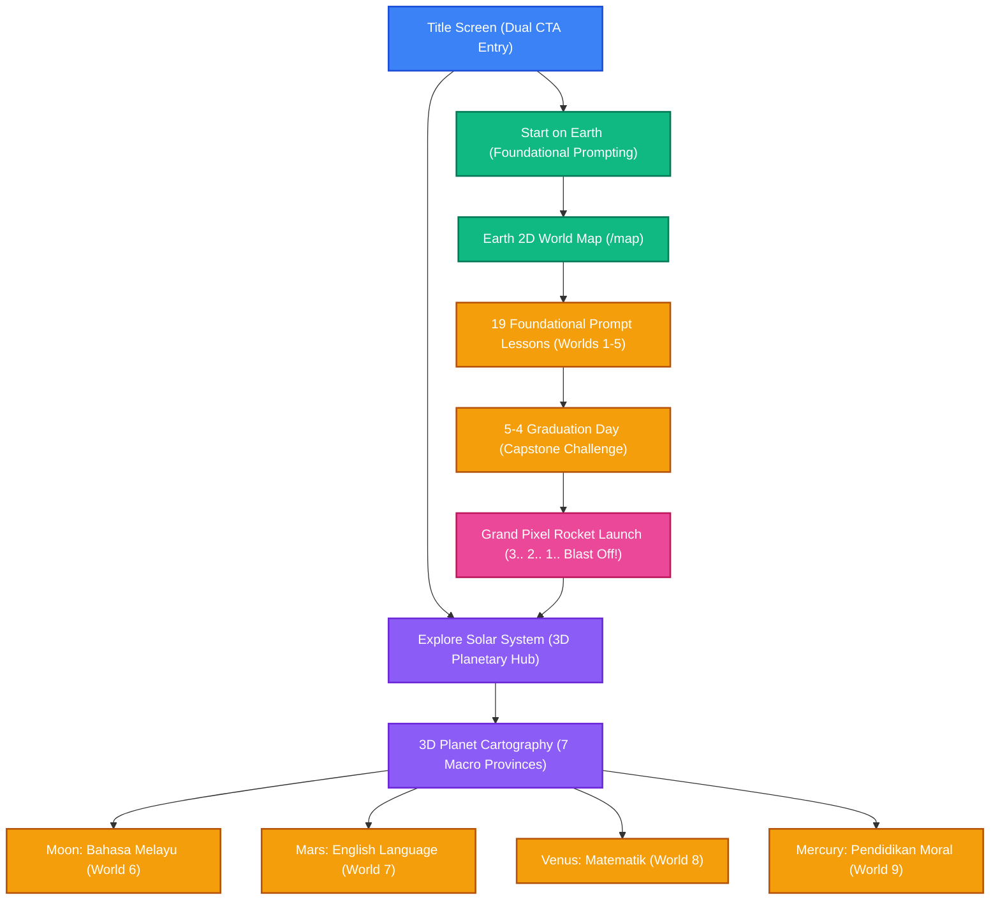

<h1 align="center">Sekolah Prompt-Fu</h1>

<p align="center">
  <strong>A playful way for kids to learn how to talk to AI — aligned with Malaysian KSSR & KBAT.</strong>
</p>

<p align="center">
  <a href="README.ms-MY.md">🇲🇾 Baca dalam Bahasa Melayu</a> | <strong>English</strong>
</p>

---

## 🌟 What is Sekolah Prompt-Fu?

**Sekolah Prompt-Fu** is a lightweight, standalone, gamified browser application designed to teach primary school students (Standard 1–6) prompt engineering and AI literacy. Players embark on an interstellar journey with **Peromfu the Robot**, traveling across celestial worlds where subject learning (Bahasa Melayu, English, Mathematics, Science, and Moral Education) serves as authentic context for prompt tasks.

The application is built 100% static (`output: 'export'`) with client-side persistence and zero server dependencies, fully localized in Bahasa Melayu (`ms`) and English (`en`), and deployed directly to GitHub Pages.

---

## 🎮 Game Flow & Architecture



---

## 🪐 3D Planetary System & Curriculum Mapping

From the Title Screen, cadets can enter the **3D Planetary Explorer** powered by Three.js and inspect the celestial worlds:

| Planet / World | Subject Focus | Geological Features (Tahun 1–6 + Boss) |
|---|---|---|
| 🌍 **Earth (Bumi)** | Foundational Prompting (19 Core Levels) | 7 Continents / Oceans & Planetary Launchpad |
| 🌕 **Moon (Bulan)** | Bahasa Melayu (`moon-bm`) | Oceanus Procellarum, Imbrium Basin, Tranquility Cluster, Highlands, South Pole-Aitken |
| 🔴 **Mars (Marikh)** | English Language (`mars-english`) | Olympus Mons, Tharsis Rise, Valles Marineris, Hellas Planitia, Utopia |
| 🟡 **Venus (Zuhrah)** | Mathematics (`venus-matematik`) | Ishtar Terra, Aphrodite Terra, Maxwell Montes, Beta Regio, Maat Mons |
| 🔘 **Mercury (Utarid)** | Moral Education (`mercury-moral`) | Caloris Basin, Borealis Planitia, Rembrandt, Beethoven, Rachmaninoff |

### 🚀 Key Features

- **Interactive 3D Solar System Hub**: Two-level navigation between the Solar System overview (Sun with revolving orbits) and deep 3D planet cartography with 7 boundary rings and pulsing beacon pins.
- **Optimized NASA Textures**: Bundled in-repo equirectangular textures (< 750 KB total) with CC-BY-4.0 attribution, loading instantly with zero external CDN dependence.
- **7-Stage Interactive Lessons**: Every subject lesson features at least 7 structured `<Section>` stages:
  1. *Mission Briefing* (Peromfu story introduction)
  2. *Core Concept Demonstration* (Prompt structuring)
  3. *Word Predictor Challenge* (Keywords & parts of speech)
  4. *Drag & Drop Assembly* (Structuring sentence fragments)
  5. *Magic Words Challenge* (Constraints & style modifiers)
  6. *Prompt Doctor* (Debugging vague or incomplete prompts)
  7. *Mastery Boss Challenge* (Capstone prompt task with `<LevelComplete>` celebration)
- **Grand Rocket Launch Sequence**: Completing Earth's graduation lesson (`5-4-graduation-day`) launches Peromfu into space with a retro 3.. 2.. 1.. BLAST OFF! countdown animation transitioning to `/planets`.
- **Dynamic Celestial Theming**: Lesson backgrounds dynamically adapt their atmosphere (sunny Earth sky, cosmic lunar slate, Martian rust-red dust, Venusian sulfur glow, and Mercury violet dusk).
- **Fast Bilingual Toggle**: 1-click `[ BM | EN ]` language switcher in the header with zero English fallback residue.

---

## 🛠️ Tech Stack

- **Framework:** Next.js 16 (App Router with `output: 'export'`) & React 19
- **3D Graphics:** Three.js (`^0.187.0`) with OrbitControls & WebGL
- **Language:** TypeScript 5
- **Styling:** Tailwind CSS 4 with custom pixel-art UI components
- **Content:** MDX interactive lessons (`src/content/kids/en/*.mdx` & `src/content/kids/ms/*.mdx`)
- **Internationalization:** `next-intl` with full parity between English (`en`) and Bahasa Melayu (`ms`)
- **Testing & Verification:** Vitest (245 unit/component tests), ESLint, import closure check, and Malay vocabulary guard

---

## 🚀 Getting Started

```bash
# Install dependencies
npm install

# Start local dev server at http://localhost:3000
npm run dev

# Run unit and component test suite
npm test

# Check import closure & Malay vocabulary guards
npm run check:closure
npm run check:vocab

# Run linter
npm run lint

# Build 100% static export (out/)
npm run build

# Run comprehensive NFR-2 verification script
npm run verify
```

---

## 💾 How Progress is Stored

All player state lives securely in the browser's `localStorage`:

- Stars earned and levels completed across all 23 levels
- Sound, music, and volume settings
- Active UI locale preference (`ms` or `en`)

Because state is client-local, the game requires no database, user accounts, sessions, or cloud server costs.

---

## 📁 Project Structure

```
src/
├── app/                  # Next.js App Router (/, /map, /planets, /level/[slug])
├── components/
│   ├── kids/
│   │   ├── layout/       # Shell, header, home content, background, progress map
│   │   ├── elements/     # Pixel-art sprites, LevelComplete, RocketLaunchOverlay
│   │   ├── consumers/    # Interactive MDX widgets (WordPredictor, DragDropPrompt, etc.)
│   │   └── planets/      # Three.js Canvas, Solar System, Cartography, HUD
│   └── providers/        # i18n and level state providers
├── content/
│   └── kids/
│       ├── en/           # 23 English interactive MDX lessons
│       └── ms/           # 23 Bahasa Melayu interactive MDX lessons
├── lib/
│   ├── kids/             # levels.ts, planets.ts, progress.ts, level-content.ts
│   └── i18n/             # Locale configuration
└── __tests__/            # Vitest unit, component, and static route tests
messages/                 # Symmetrical en.json & ms.json translation dictionaries
public/
│   ├── images/planets/   # Bundled NASA textures & ATTRIBUTION.md
│   ├── og.png            # Custom Sekolah Prompt-Fu social preview banner
│   └── kids-music.mp3    # Bundled background soundtrack
scripts/                  # verify-project.js, check-ms-vocabulary.js, check-kids-import-closure.js
```

---

## 📜 Documentation & Translations

- [English Documentation (README.md)](README.md)
- [Dokumentasi Bahasa Melayu (README.ms-MY.md)](README.ms-MY.md)

---

## 📄 License

Released under the [MIT License](LICENSE). Planetary textures licensed under [CC-BY-4.0](public/images/planets/ATTRIBUTION.md).
