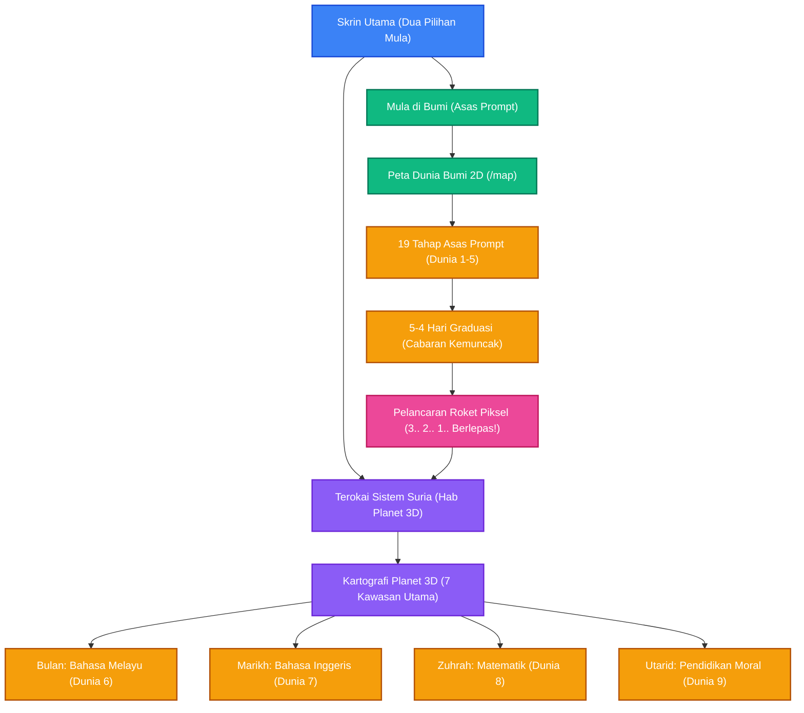

<h1 align="center">Sekolah Prompt-Fu</h1>

<p align="center">
  <strong>Cara seronok untuk murid belajar berkomunikasi dengan AI — selaras dengan sukatan KSSR Semakan & KBAT Malaysia.</strong>
</p>

<p align="center">
  <strong>Bahasa Melayu</strong> | <a href="README.md">🇬🇧 Read in English</a>
</p>

---

## 🌟 Apakah itu Sekolah Prompt-Fu?

**Sekolah Prompt-Fu** ialah sebuah aplikasi web permainan interaktif yang ringan, berdikari (standalone), dan mesra kanak-kanak untuk murid sekolah rendah (Tahun 1–6) mempelajari kejuruteraan prompt (*prompt engineering*) dan literasi kecerdasan buatan (AI). Pemain menyertai pengembaraan angkasa bersama **Peromfu si Robot**, meneroka dunia cakerawala di mana konteks mata pelajaran sekolah (Bahasa Melayu, Bahasa Inggeris, Matematik, Sains, dan Pendidikan Moral) dijadikan asas pembelajaran prompt yang bermakna.

Aplikasi ini dibina 100% statik (`output: 'export'`) dengan penyimpanan kemajuan di sisi pelayar web (*client-side persistence*), sifar pergantungan pelayan luar (*serverless*), dwibahasa penuh (Bahasa Melayu `ms` dan Bahasa Inggeris `en`), serta dihoskan di GitHub Pages.

---

## 🎮 Aliran Permainan & Seni Bina (*Game Flow*)



---

## 🪐 Sistem Planet 3D & Pemetaan Kurikulum

Dari Skrin Utama, murid boleh memasuki **Penjelajah Planet 3D** yang dijana oleh Three.js untuk melihat sistem suria dan meneroka bentuk muka bumi planet:

| Planet / Dunia | Tumpuan Mata Pelajaran | Ciri Geologi (Tahun 1–6 + Bos) |
|---|---|---|
| 🌍 **Bumi (Earth)** | Asas Prompting (19 Tahap Utama) | 7 Benua / Lautan & Tapak Pelancaran Roket |
| 🌕 **Bulan (Moon)** | Bahasa Melayu (`moon-bm`) | Lautan Procellarum, Lembangan Imbrium, Laut Ketenangan, Tanah Tinggi, Kutub Selatan-Aitken |
| 🔴 **Marikh (Mars)** | Bahasa Inggeris (`mars-english`) | Olympus Mons, Tharsis Rise, Valles Marineris, Hellas Planitia, Utopia |
| 🟡 **Zuhrah (Venus)** | Matematik (`venus-matematik`) | Ishtar Terra, Aphrodite Terra, Maxwell Montes, Beta Regio, Maat Mons |
| 🔘 **Utarid (Mercury)** | Pendidikan Moral (`mercury-moral`) | Caloris Basin, Borealis Planitia, Rembrandt, Beethoven, Rachmaninoff |

### 🚀 Ciri-Ciri Utama

- **Hab Sistem Suria 3D Interaktif**: Navigasi dua peringkat antara pandangan Sistem Suria (Matahari dengan orbit planet) dan kartografi 3D terperinci setiap planet lengkap dengan 7 gelung sempadan dan pin suar berkilau.
- **Tekstur NASA Teroptimum**: Tekstur permukaan planet resolusi tinggi yang dimampatkan rapi (< 750 KB keseluruhan) dengan atribusi CC-BY-4.0, memuat serta-merta tanpa kebergantungan CDN luar.
- **Pembelajaran 7 Peringkat**: Setiap pelajaran mata pelajaran mempunyai sekurang-kurangnya 7 bahagian interaktif (`<Section>`):
  1. *Taklimat Misi* (Pengenalan cerita bersama Peromfu)
  2. *Demonstrasi Konsep Asas* (Cara menyusun arahan prompt yang berkesan)
  3. *Cabaran Pemilih Kata* (Kata kunci dan golongan kata)
  4. *Susun Blok Prompt* (Menyusun frasa watak, aksi, dan latar)
  5. *Kata Ajaib & Gaya* (Menetapkan syarat dan format)
  6. *Doktor Prompt* (Membaiki prompt yang samar atau rosak)
  7. *Cabaran Kemuncak / Bos* (Cabaran penguasaan lengkap bersama sambutan `<LevelComplete>`)
- **Pelancaran Roket Beranimasi**: Sebaik sahaja menamatkan tahap graduasi Bumi (`5-4-graduation-day`), skrin memaparkan kiraan detik pelancaran roket gaya retro (3.. 2.. 1.. Berlepas!) sebelum membawa pemain ke hab planet `/planets`.
- **Tema Visual Dinamik**: Latar belakang setiap tahap berubah mengikut planet semasa (langit biru Bumi, kelabu kosmik Bulan, merah berdebu Marikh, kabus keemasan Zuhrah, dan senja ungu Utarid).
- **Pertukaran Bahasa Pantas**: Butang dwibahasa pantas `[ BM | EN ]` pada bar navigasi atas tanpa sebarang keciciran perkataan Inggeris.

---

## 🛠️ Rangka Kerja & Teknologi

- **Rangka Kerja:** Next.js 16 (App Router dengan `output: 'export'`) & React 19
- **Grafik 3D:** Three.js (`^0.187.0`) bersama OrbitControls & WebGL
- **Bahasa Pengaturcaraan:** TypeScript 5
- **Gaya Visual:** Tailwind CSS 4 dengan komponen seni piksel (*pixel-art*)
- **Kandungan:** Tahap interaktif MDX (`src/content/kids/ms/*.mdx` & `src/content/kids/en/*.mdx`)
- **Penterjemahan:** `next-intl` dengan padanan istilah penuh BM dan EN
- **Ujian & Pengesahan Kualiti:** Vitest (245 ujian unit/komponen), ESLint, semakan penutupan import (`check:closure`), dan kawalan kosa kata Melayu (`check:vocab`)

---

## 🚀 Memulakan Pembangunan Tempatan

```bash
# Pasang kebergantungan pakej
npm install

# Jalankan pelayan pembangunan tempatan di http://localhost:3000
npm run dev

# Jalankan suite ujian unit dan komponen
npm test

# Jalankan semakan import dan pengawal kosa kata BM
npm run check:closure
npm run check:vocab

# Jalankan linter
npm run lint

# Bina eksport statik 100% (folder out/)
npm run build

# Jalankan skrip pengesahan menyeluruh NFR-2
npm run verify
```

---

## 💾 Cara Kemajuan Disimpan

Segala rekod kemajuan pemain disimpan dalam pelayar (`localStorage`):

- Jumlah bintang diperoleh dan tahap yang diselesaikan (23 tahap)
- Tetapan bunyi, muzik latar, dan tahap kelantangan
- Pilihan bahasa antaramuka (`ms` atau `en`)

Oleh sebab data disimpan di pelayar peranti, aplikasi ini selamat, percuma, dan tidak memerlukan pangkalan data atau akaun pengguna.

---

## 📁 Struktur Projek

```
src/
├── app/                  # Laluan Next.js App Router (/, /map, /planets, /level/[slug])
├── components/
│   ├── kids/
│   │   ├── layout/       # Rangka halaman, header, latar belakang dinamik, peta
│   │   ├── elements/     # Komponen seni piksel, LevelComplete, RocketLaunchOverlay
│   │   ├── consumers/    # Widget interaktif MDX (WordPredictor, DragDropPrompt, dll.)
│   │   └── planets/      # Kanvas Three.js, Sistem Suria, Kartografi, HUD
│   └── providers/        # Pembekal konteks i18n dan tahap
├── content/
│   └── kids/
│       ├── ms/           # 23 pelajaran interaktif Bahasa Melayu
│       └── en/           # 23 pelajaran interaktif Bahasa Inggeris
├── lib/
│   ├── kids/             # levels.ts, planets.ts, progress.ts, level-content.ts
│   └── i18n/             # Konfigurasi bahasa
└── __tests__/            # Ujian unit Vitest, komponen, dan laluan statik
messages/                 # Kamus terjemahan simetri en.json & ms.json
public/
│   ├── images/planets/   # Tekstur planet NASA & ATTRIBUTION.md
│   ├── og.png            # Sepanduk pratonton rasmi Sekolah Prompt-Fu
│   └── kids-music.mp3    # Lagu latar tema kanak-kanak
scripts/                  # verify-project.js, check-ms-vocabulary.js, check-kids-import-closure.js
```

---

## 📜 Dokumentasi Berkaitan

- [Dokumentasi Bahasa Melayu (README.ms-MY.md)](README.ms-MY.md)
- [English Documentation (README.md)](README.md)

---

## 📄 Lesen

Dilesenkan di bawah [Lesen MIT](LICENSE). Tekstur planet dilesenkan di bawah [CC-BY-4.0](public/images/planets/ATTRIBUTION.md).
